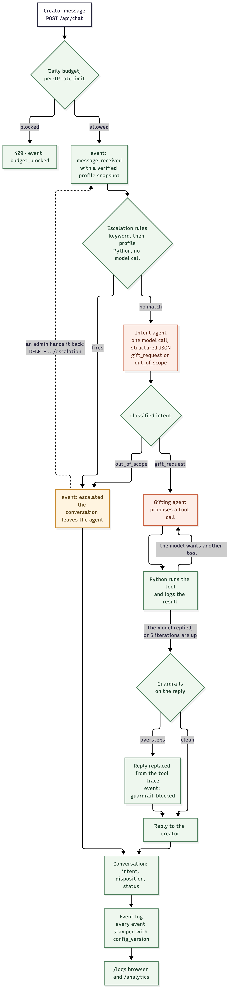
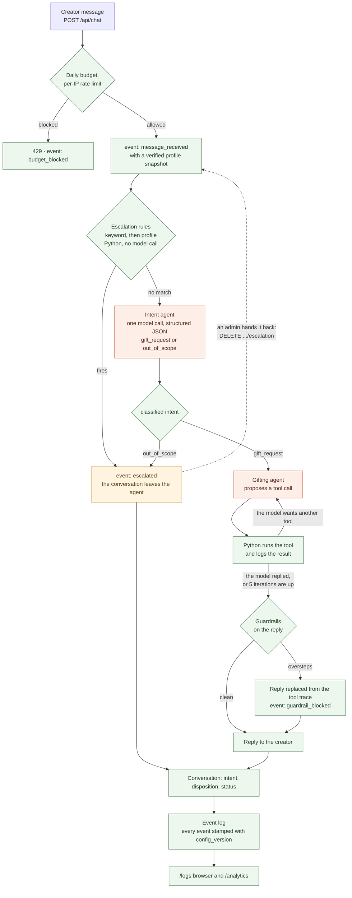
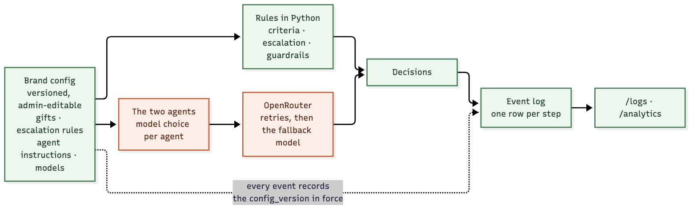
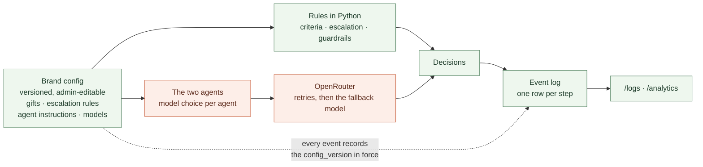

# Agent architecture

One specialist agent, a bounded tool loop, and a lot of Python. The gifting agent is the
only agent that answers anything: a request it is not for goes to a person rather than to
another model. A gifting turn costs one model call to classify, plus a tool loop bounded
at five iterations; an out-of-scope turn costs the classification and nothing else. Every
decision that matters — who qualifies, whether a conversation escalates, what a reply is
allowed to claim — is made in Python.

> **The model proposes. Python decides.**

Colour in the diagrams below is the same code as the rest of the app: coral is a model,
sage is Python, amber is a hand-off to a human.

---

## One creator turn



<details>
<summary>Mermaid source</summary>



</details>

**The loop.** The gifting agent runs the usual agent cycle — the model asks for a tool,
Python runs it and returns the result, the model sees it and goes again — bounded at
**5 iterations**. Two tools are *required* before it may answer (`get_creator_profile`
and `check_gifting_eligibility`), so a cheap model that skips the lookup is nudged back
until it does the work.

**The exits.** Two of the three escalation triggers are decided *before* the router runs
(the creator's own words, and a rule about their verified profile), so those turns cost
nothing at all. The third — a request the intent agent classifies as out of scope — is
decided after it, but the hand-off is still Python's: the model classifies, it does not
choose. In all three cases no agent runs, and a follow-up is *held* rather than answered.

**The guardrails.** A reply is checked against what the tools actually did before the
creator sees it. Four ways it can be replaced, each logged as `guardrail_blocked`:

| Check | Catches |
|---|---|
| `one_gift_per_conversation` | a second gift in the same conversation — answered from the rule, naming the order that exists |
| `ungrounded_gift_claim` | "your gift is on its way" when no tool produced an order |
| `ungrounded_escalation_claim` | claiming a hand-off to a person that never happened |
| `system_prompt_leak` | the reply echoing its own instructions |

---

## Who decides what

| Decision | Made by |
|---|---|
| Is this a request we have an agent for? | **Model** — one structured classification |
| Which tool to call, in what order, and how to word the reply | **Model** |
| Whether the creator qualifies for a gift | **Python** — `criteria_evaluated` over the verified profile |
| Whether an order may be placed | **Python** — `issue_gift` re-runs the criteria itself and refuses if anything is unmet |
| Whether the conversation escalates | **Python** — three triggers, before or around the router |
| What a reply may claim | **Python** — the guardrails, from the tool trace |
| Which rules apply | **Python** — the versioned config, stamped on every event |

---

## The two agents

| | Intent agent | Gifting agent |
|---|---|---|
| File | `agents/router_agent.py` | `agents/tool_agent.py` + `agents/prompts.py` |
| Model | `models.router` | `models.gift_request` |
| Tools | none | `get_creator_profile`, `find_available_gifts`, `check_gifting_eligibility`, `validate_shipping_address`, `issue_gift` |
| Output | structured JSON: intent, confidence, reasoning | a reply, plus the tool trace behind it |
| Hand-off | `event: intent_classified` | `event: agent_handoff` (or `agent_resumed` when continuing a pending task) |
| Instructions | editable in `/admin` → **Intent agent** | editable in `/admin` → **Gifting agent** |

---

## The layers around them



<details>
<summary>Mermaid source</summary>



</details>

None of that is hard-coded: thresholds, escalation keywords, the agent instructions and
even the model each agent runs on live in the config, which is stored in the database and
editable at `/admin` without a deploy. Every event records the version in force, so the
audit trail proves which rules applied to a decision.

---

## Where this lives in the code

| Step | File |
|---|---|
| The whole turn, in order | `backend/app/orchestrator.py` |
| Intent classification | `backend/app/agents/router_agent.py` |
| Tool loop, required-tool nudging | `backend/app/agents/tool_agent.py` |
| Prompts for both agents | `backend/app/agents/prompts.py` |
| Tool schemas, validation, guarded executors | `backend/app/tools/registry.py` |
| Eligibility, criteria, duplicate gifts | `backend/app/evaluation.py`, `backend/app/metrics.py` |
| Escalation triggers | `backend/app/escalation.py` |
| Injection detection and reply checks | `backend/app/guardrails.py` |
| Config loading, versioning, reseeding | `backend/app/services/config_manager.py` |
| Model calls, retries, fallback | `backend/app/services/llm_client.py` |
| Session cap, daily budget, rate limit | `backend/app/services/budget.py` |
| Event log | `backend/app/services/event_logger.py` |

The README has the same request path as a compact text diagram, alongside the demo
scenarios and what each one is meant to show.

---

## Regenerating the images

The two PNGs in `docs/` are rendered from the Mermaid source above with
[`@mermaid-js/mermaid-cli`](https://github.com/mermaid-js/mermaid-cli), so an edit to a
diagram needs one command to reach the image:

```bash
npx -y @mermaid-js/mermaid-cli -i ARCHITECTURE.md -o /tmp/out.md -e png -s 2 -b white
cp /tmp/out-1.png docs/agent-flow.png
cp /tmp/out-2.png docs/agent-flow-layers.png
```

`-s 2` renders at double size, which is what keeps the text sharp when the image is
displayed at half width.
